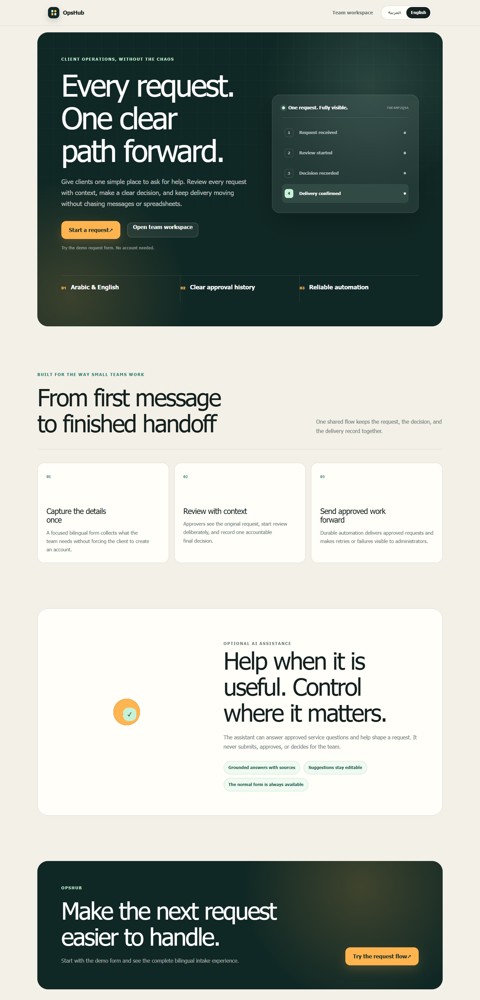
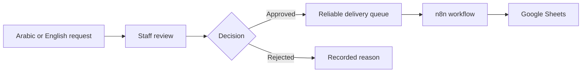

# OpsHub

OpsHub helps small businesses and teams turn incoming service requests into a
clear, reliable workflow. Requesters can use Arabic or English, staff can review
and approve each request, and approved work is delivered to the tools the team
already uses.



## Why I built it

Requests often arrive through a mix of messages, forms, and spreadsheets. That
makes details easy to lose, decisions hard to trace, and automation failures
easy to miss. I built OpsHub to keep the full journey in one place without
making a small team adopt a complicated workflow platform.



The first release intentionally solves one workflow well: collect a structured
service request, review it, record the decision, and deliver approved work
reliably.

## What it can do

- Serve complete Arabic RTL and English LTR experiences
- Accept requests from individuals and companies without requiring an account
- Normalize phone numbers, websites, dates, and consent details on the server
- Give approvers and administrators secure access scoped to their organization
- Move requests through `submitted -> under_review -> approved | rejected`
- Keep immutable request snapshots and an activity timeline that only adds events
- Create delivery work atomically when a request is approved
- Retry failed deliveries safely without erasing attempt history
- Send webhooks signed with HMAC to n8n and update Google Sheets by request reference
- Offer an optional bilingual intake assistant that proposes editable form
  values while the normal form and human approval remain in control

The [Arabic mobile preview](docs/assets/screenshots/opshub-home-ar-mobile.png),
[request form](docs/assets/screenshots/opshub-request-en.png), and
[Arabic staff sign-in](docs/assets/screenshots/opshub-staff-signin-ar-mobile.png)
show the main public and staff experiences.

## How reliability is handled

OpsHub treats the database as the system of record. Authorization is enforced
on the server and in PostgreSQL, and composite tenant keys prevent records from
being connected across organizations. Final decisions and delivery creation
happen in one transaction.

External delivery happens outside that transaction through a durable queue.
Workers use short claims, leases, and fencing tokens. Because delivery is at
least once, the n8n receiver uses the stable request reference to update the
same Google Sheets row instead of creating duplicates.

## Current status

| Area                                        | Status                                                              |
| ------------------------------------------- | ------------------------------------------------------------------- |
| Core request, review, and delivery workflow | Implemented and verified locally                                    |
| Arabic and English interfaces               | Implemented and tested on desktop and mobile                        |
| n8n and Google Sheets integration           | Verified locally with append and duplicate update evidence          |
| Optional AI intake                          | Implemented and evaluated with a deterministic 50 case mock suite   |
| Shareable public demo                       | Verified through a temporary HTTPS tunnel using synthetic data      |
| Permanent production hosting                | Not deployed; intended to be configured for each team's environment |

The temporary public demo runs from a local machine and is available only while
the local stack and tunnel are running. It is not an always available production
service. The AI adapter has not been evaluated with a live provider key, so the
assistant stays disabled or in mock mode for public demonstrations.

## Technology

| Area                    | Tools                                                   |
| ----------------------- | ------------------------------------------------------- |
| Web                     | Next.js, React, TypeScript, Tailwind CSS, next-intl     |
| Forms                   | React Hook Form, Zod, libphonenumber-js                 |
| Data and authentication | Supabase, PostgreSQL, Supabase Auth, Row Level Security |
| Automation              | TypeScript worker, n8n Community Edition, Google Sheets |
| Optional AI service     | FastAPI, Pydantic, bilingual lexical retrieval          |
| Verification            | Vitest, Testing Library, Playwright, pgTAP, axe-core    |

Exact versions are locked in the repository manifests.

## Run it locally

You need Node.js 24, npm 11, and Docker Desktop.

```powershell
npm.cmd ci
npm.cmd --prefix apps/web ci
npm.cmd --prefix apps/worker ci
npm.cmd --prefix apps/web exec playwright install chromium
npm.cmd run db:start
```

Create the local web environment file:

```powershell
Copy-Item apps/web/.env.example apps/web/.env.local
npx.cmd supabase status -o env
```

Map `API_URL` to `NEXT_PUBLIC_SUPABASE_URL`, `PUBLISHABLE_KEY` to
`NEXT_PUBLIC_SUPABASE_PUBLISHABLE_KEY`, and `SECRET_KEY` to
`SUPABASE_SECRET_KEY`. Generate a separate random value of at least 32
characters for `PUBLIC_SUBMISSION_RATE_LIMIT_KEY`, then start the app:

```powershell
npm.cmd --prefix apps/web run dev
```

The local Supabase stack is for development only. Environment files, provider
keys, Google credentials, and real requester data must never be committed.

For the complete local automation flow, follow the
[n8n receiver setup](n8n/README.md). For a temporary USD 0 public demonstration,
use the [zero cost demo guide](docs/deployment/zero-cost-demo-setup.md).

## Verify it

The main repeatable checks are:

```powershell
npm.cmd run db:test
npm.cmd --prefix apps/web test
npm.cmd --prefix apps/web run typecheck
npm.cmd --prefix apps/web run lint
npm.cmd --prefix apps/web run build
npm.cmd --prefix apps/web run test:e2e
npm.cmd run worker:test
npm.cmd run worker:typecheck
npm.cmd run worker:build
npm.cmd run n8n:test
```

The browser journey creates a temporary synthetic administrator and request,
tests the full workflow, and removes the local records afterward. The latest
verified results are recorded in the
[release readiness report](docs/testing/phase-9-release-readiness.md) and
[zero cost demo preflight](docs/testing/zero-cost-demo-preflight.md).

## Documentation

Start with the [documentation index](docs/README.md), or open one of these key
documents:

- [Core MVP specification](docs/product/mvp-spec.md)
- [Engineering design](docs/architecture/phase-2b-engineering-design.md)
- [Production and deployment design](docs/architecture/phase-9-production-deployment.md)
- [Core MVP hardening evidence](docs/testing/phase-7-core-mvp-hardening.md)
- [Optional AI evaluation](docs/testing/phase-8d-evaluation-and-hardening.md)
- [Case study](docs/portfolio/opshub-case-study.md)
- [Three minute demo script](docs/portfolio/demo-script.md)

## Scope

The current product has one fixed request form, one approval step, and one
Google Sheets destination. Request tracking, automatic requester notifications,
custom workflow builders, and additional connectors are intentionally outside
this release. Staff contact requesters manually using their preferred contact
method.
