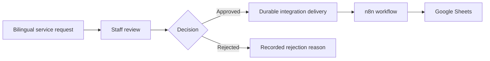

# OpsHub

I am building OpsHub to help small businesses and teams manage service requests,
approvals, and business automation in one clear place. It supports both Arabic
and English so each team can work in the language that suits them.

Many teams still receive requests through messages, forms, and spreadsheets.
Important details can get lost, approvals become difficult to follow, and a
failed automation may go unnoticed. OpsHub is designed around these real
problems and aims to make the whole process easier to manage and trust.

OpsHub is currently in active development. The product and engineering design
are approved, and the application is being built step by step. The features
below describe the planned first release unless they are marked as completed.

## What I want OpsHub to solve

Small teams often receive business requests through disconnected forms,
messages, and spreadsheets. This makes approvals difficult to track and
automation failures easy to miss.

With OpsHub, the full workflow can stay in one controlled system:

## First release

I am starting with a focused release that is useful, secure, and testable:

- One predefined business service request form
- Arabic RTL and English LTR interfaces
- Individual and company request branches
- Staff authentication with approver and administrator roles
- A clear `submitted -> under_review -> approved | rejected` workflow
- Pool approval model where the first valid final decision wins
- Immutable request snapshot and append only audit timeline
- Idempotent public submission
- Reliable at least once delivery with retries and dead letter handling
- HMAC signed webhook to n8n
- Idempotent Google Sheets upsert using the request reference
- Isolation between organizations through PostgreSQL constraints and Row Level
  Security

Public request tracking, notifications, workflow builders, multiple connectors,
and AI assisted intake are planned for later stages.

## User roles

| Role | Core responsibility |
|---|---|
| Requester | Submit a service request in Arabic or English without creating an account |
| Approver | Review requests and make the first valid approval or rejection |
| Administrator | Perform approver actions and inspect or retry failed deliveries |

## Technology plan

| Area | Technology |
|---|---|
| Web application | Next.js, React, TypeScript |
| Interface | Tailwind CSS, shadcn/ui, next-intl |
| Forms and validation | React Hook Form, Zod, libphonenumber-js |
| Database and authentication | Supabase, PostgreSQL, Supabase Auth |
| Automation | TypeScript worker, n8n Community Edition, Google Sheets |
| Testing | Vitest, React Testing Library, Playwright, Supabase database tests |
| Later AI module | FastAPI, Pydantic, evaluated bilingual RAG intake |

Exact package versions will be selected and recorded when the project
foundation is created.

## How I am building it

- The browser never chooses the authoritative organization identifier.
- Authorization is enforced on the server and in PostgreSQL, not only in the UI.
- Tenant relationships use composite foreign keys to prevent links between
  organizations
- Request state and integration delivery state are separate.
- Final decisions and delivery creation are atomic.
- Workers use short database claims, leases, and fencing tokens.
- External calls happen outside database transactions.
- Retries may repeat a webhook, so the receiver performs an idempotent upsert.
- Secrets remain in server environments and never enter client bundles.
- Public demonstrations use synthetic data only.

## Delivery roadmap

- [x] Define and validate the focused product scope
- [x] Approve bilingual flows and state machines
- [x] Approve schema, RLS, RPC, worker, webhook, and testing design
- [ ] Create the reproducible project foundation
- [ ] Implement authentication and tenant isolation
- [ ] Implement request intake and staff review
- [ ] Implement reliable n8n and Google Sheets delivery
- [ ] Complete security, accessibility, and end to end verification
- [ ] Add and evaluate the optional bilingual AI intake module
- [ ] Prepare the verified project for teams that want to use or adapt it

## Current repository stage

I am building this repository through small, reviewed commits. The first steps
establish clear documentation and a reproducible foundation before feature
implementation begins.