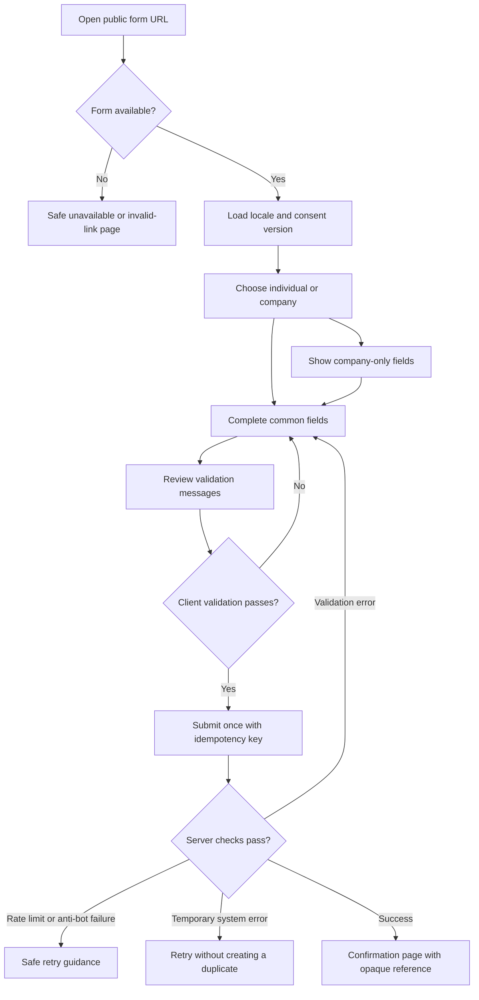
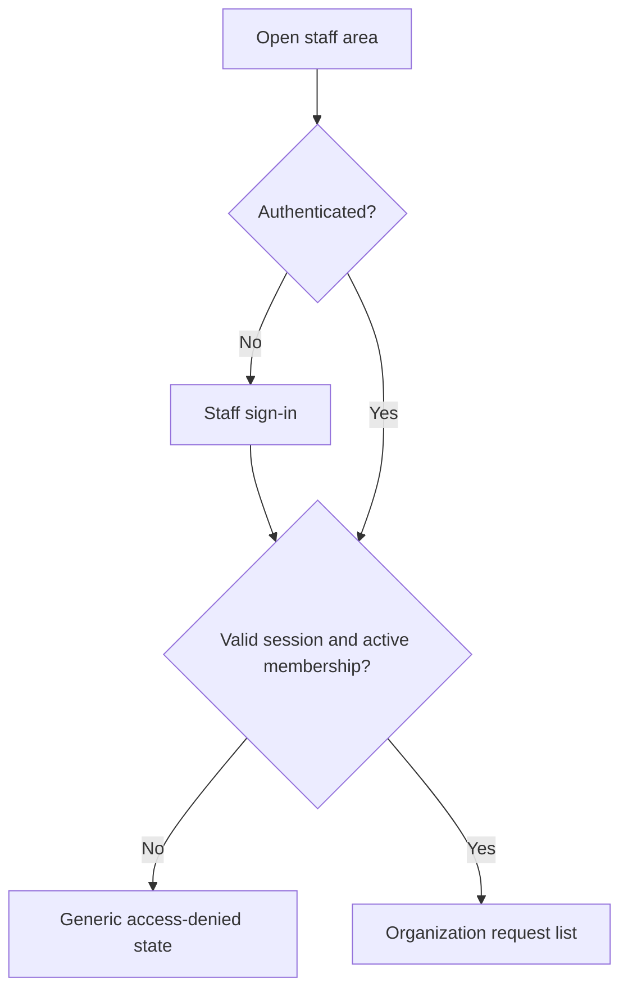
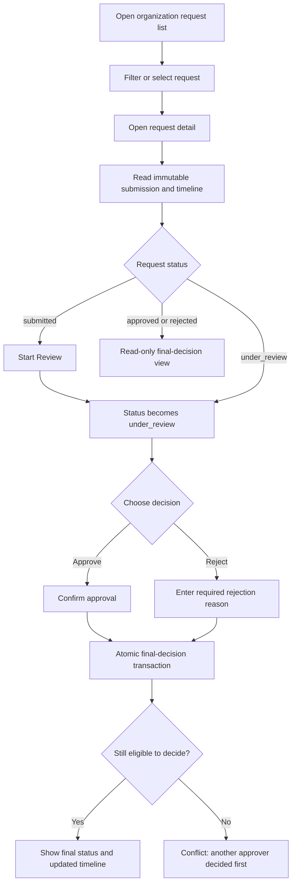
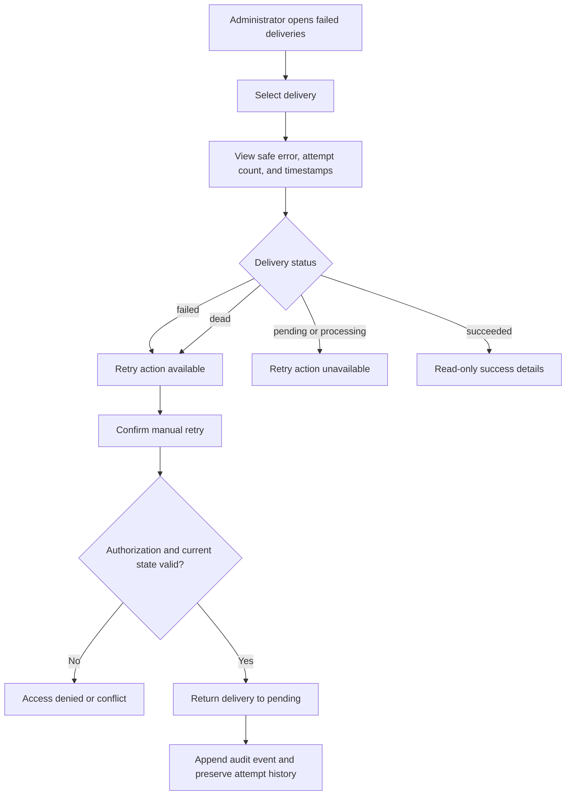
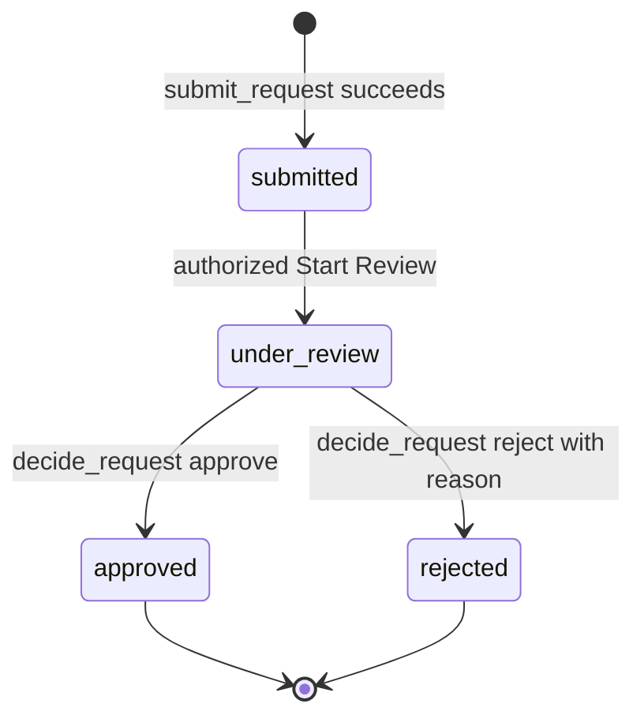
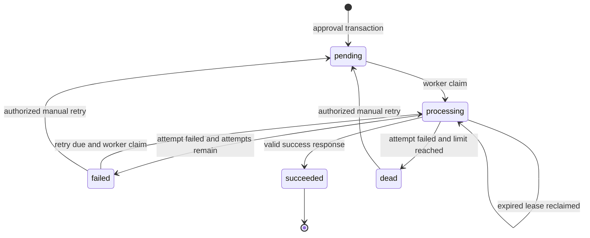

# OpsHub Phase 2 Product and Engineering Design

**Status:** Checkpoint 2A approved by Hazem<br>
**Started:** 2026-10-14<br>
**Review incorporated:** 2026-10-14<br>
**Approved input:** [`mvp-spec.md`](../product/mvp-spec.md)<br>
**Current checkpoint:** 2A and 2B approved; Checkpoint 2B is documented in
[`phase-2b-engineering-design.md`](phase-2b-engineering-design.md)

## 1. Phase 2 purpose

Phase 2 turns the approved product decisions into behavior that can be reviewed
and tested before any application code or database migration is created.

The full phase will eventually define:

1. Arabic and English user flows
2. Low-fidelity screens
3. Request state machine
4. Integration-delivery state machine
5. Database schema
6. RLS model
7. RPC boundaries and authorization rules
8. Worker claim, lease, retry, and dead-letter behavior
9. Webhook event contract and HMAC signing
10. Testing strategy
11. Short architecture decision records

This document defines items 1 through 4. Hazem approved Checkpoint 2A on
2026-10-14. Items 5 through 11 are defined in the separate Checkpoint 2B review
document.

## 2. Fixed product decisions

The following are inputs, not open questions:

- The Core MVP has one predefined B2B service-request form.
- The interface supports Arabic RTL and English LTR from the beginning.
- The fixed service categories have language-neutral stored values and Arabic
  and English labels.
- The requester does not create an account.
- Public status tracking is not included in the Core MVP.
- Staff contact the requester manually, using the preferred method when present
  and email as the fallback.
- Staff use Supabase email authentication.
- Any organization member with approver permission may make the decision.
- An administrator includes approver permission.
- The first valid final decision wins.
- Request and integration-delivery statuses are separate.
- Google Sheets is an external destination, not the system of record.
- An LLM is not required for any Core MVP action.

## 3. Personas and permissions in the flow

| Persona | Authentication | Core actions | Explicitly unavailable |
|---|---|---|---|
| Public requester | None | Choose locale, complete the fixed form, submit, receive confirmation reference | Track status, edit after submission, approve, view staff data |
| Approver | Staff account | View organization requests, start review, inspect the immutable submission, approve, reject, view timeline | Manage staff, retry integrations, access another organization |
| Administrator | Staff account | All approver actions, view failed deliveries, retry authorized deliveries, view audit history | Access another organization, edit audit history, bypass transition rules |

The pool model does not assign a request to one approver. Starting review makes
the review state explicit but does not reserve the request. Any authorized
approver may still submit the first valid final decision.

## 4. Bilingual route and direction model

Recommended locale routes:

```text
/ar/request/{publicFormId}
/en/request/{publicFormId}
/ar/staff/...
/en/staff/...
```

Rules:

- Arabic pages set `lang="ar"` and `dir="rtl"` at the document boundary.
- English pages set `lang="en"` and `dir="ltr"`.
- A locale switch retains the current logical destination when possible.
- Stored enum values, identifiers, and status values are language-neutral.
- User-entered text is displayed in its natural direction using appropriate
  bidirectional isolation for mixed Arabic, Latin text, phone numbers, URLs,
  and references.
- Layout uses logical start/end spacing and alignment rather than hard-coded
  left/right assumptions.
- Arabic and English flows have equal validation, error, loading, empty, and
  success states.

## 5. Public requester journey

### 5.1 Main flow



### 5.2 Detailed behavior

1. The public URL contains a high-entropy public form identifier, not an
   organization identifier chosen by the browser.
2. The requester may switch between Arabic and English before submitting.
3. The requester chooses `individual` or `company`.
4. Company-only fields appear only for `company`.
5. The form validates required fields and normalized formats without losing the
   requester's original phone input.
6. A valid phone/country mismatch displays a warning but does not block
   submission.
7. The description includes a notice not to submit secrets, payment details,
   passwords, or unnecessary identity information.
8. Consent must be selected before submission. The server records the consent
   text version, locale, and server timestamp.
9. The submit action sends an idempotency key. Repeating that submission returns
   the original successful result rather than creating another request.
10. A separate submission with a different idempotency key creates a separate
    request even if the content is identical.
11. Success displays the 10-character Crockford Base32 confirmation reference
    and explains that staff will contact the requester manually.
12. The confirmation page does not expose a tracking link or request data.

### 5.3 Public error behavior

| Condition | User-visible behavior | Must not reveal |
|---|---|---|
| Invalid or disabled form identifier | Generic unavailable-form message | Organization existence or internal identifiers |
| Field validation error | Inline message, summary, and focus to first invalid field | Stack trace or database detail |
| Phone cannot be normalized | Ask for a valid number and retain the entered value | Library or parsing internals |
| Phone and country differ but number is valid | Non-blocking warning and allow submission | Internal risk score |
| Honeypot failure | Generic submission failure with retry guidance | Which anti-abuse rule triggered |
| Rate limited | Explain when the requester may try again | Raw IP address or rate-limit key |
| Temporary server failure before commit | Keep entered fields locally and allow safe retry | Internal service names or SQL errors |
| Repeated successful idempotency key | Return the original confirmation result | Whether a second insert was attempted |

## 6. Staff authentication and request-review journey

### 6.1 Authentication flow



Authentication success alone is insufficient. Every staff view and action also
requires an active membership in the row's organization.

### 6.2 Review and decision flow



### 6.3 Decision rules

- Opening the detail page does not change the request status.
- `Start Review` is required before approval or rejection.
- `Start Review` is not an assignment and does not lock other approvers out.
- `start_review()` is idempotent when the request is already `under_review`.
  A second authorized caller receives the current under-review result rather than
  a conflict.
- Approval and rejection are available only from `under_review`.
- Rejection requires a non-empty reason that passes the defined length limit.
- Approval requires a confirmation step but no invented approval reason.
- The final decision transaction rechecks membership, effective role, and
  current request state.
- The UI state is never trusted as authorization evidence.
- If another approver commits first, the losing action receives a conflict and
  refreshes to the recorded final decision.
- Approved requests create the integration delivery in the same database
  transaction as the approval decision and audit event.
- Rejected requests do not create an integration delivery.
- Finalized requests are read-only in the Core MVP.

## 7. Integration failure and retry journey



Only administrators may manually retry. A manual retry does not call the
external webhook inside the browser request. It changes durable database state;
the worker later claims and processes the delivery.

## 8. Request state machine

### 8.1 States

| State | Meaning | User-visible owner |
|---|---|---|
| `submitted` | A complete request was committed with its immutable snapshot and submission audit event | Approver pool |
| `under_review` | An authorized staff member explicitly started review; no approver owns the request exclusively | Approver pool |
| `approved` | The first valid approval decision committed; an integration delivery was created atomically | Final, read-only |
| `rejected` | The first valid rejection decision committed with a reason | Final, read-only |

### 8.2 Valid transitions



### 8.3 Transition matrix

| From | Action | Required actor | To | Atomic side effects | Invalid-state behavior |
|---|---|---|---|---|---|
| None | Submit | Public server boundary | `submitted` | Request, snapshot, consent record/data, and audit event | Validation error or idempotent replay result |
| `submitted` | Start Review | Approver or administrator | `under_review` | Status update, `review_started` timestamp, and audit event | Return the current state without an error if already `under_review`; conflict if finalized |
| `under_review` | Approve | Approver or administrator | `approved` | Decision, audit event, and one pending integration delivery | Conflict if another final decision won |
| `under_review` | Reject | Approver or administrator | `rejected` | Decision with reason and audit event | Conflict if another final decision won |

No Core MVP transition returns an approved or rejected request to an earlier
state. Corrections require a new request or a future explicitly designed
administrative process.

## 9. Integration-delivery state machine

### 9.1 States

| State | Meaning |
|---|---|
| `pending` | Durable delivery exists and is eligible when `available_at` is reached |
| `processing` | A worker atomically claimed the delivery and owns a time-limited lease |
| `succeeded` | The receiver returned a valid success result after the idempotent Sheets effect |
| `failed` | The last attempt failed, attempts remain, and a future retry time is scheduled |
| `dead` | The maximum automatic attempt count was exhausted; administrator review is required |

### 9.2 Automatic transitions



### 9.3 Delivery invariants

- Request status never changes because delivery succeeds or fails.
- One approved request produces one delivery for the single Core MVP
  destination.
- Claiming uses a database transaction and row locking with `SKIP LOCKED`.
- The claim transaction commits before the external HTTP call starts.
- `locked_at` and `locked_until` define the lease.
- An expired `processing` lease may be reclaimed.
- A retry may repeat an external call after an uncertain result. Therefore the
  receiver must use the stable request reference to append or update, not append
  blindly.
- The system claims at-least-once delivery with an idempotent external effect,
  not distributed exactly-once delivery.
- Every attempt is preserved in append-only attempt history.
- Automatic retry uses exponential backoff with jitter and stops at the maximum
  attempt count.
- A manual retry requires administrator authorization and creates an audit
  event. Its detailed attempt-budget rule remains for Checkpoint 2B.
- The application never holds a database transaction open while waiting for
  n8n, Google Sheets, or another external service.

## 10. Low-fidelity screen inventory

| ID | Screen | Persona | Required states |
|---|---|---|---|
| PUB-01 | Public service-request form | Requester | Loading, ready, field errors, phone warning, submitting, verification failure, rate limited, system error |
| PUB-02 | Submission confirmation | Requester | Success and idempotent replay success |
| PUB-03 | Form unavailable | Requester | Invalid, disabled, or unavailable public form without information leakage |
| STF-01 | Staff sign-in | Approver/admin | Ready, submitting, invalid credentials, access denied |
| STF-02 | Request list | Approver/admin | Loading, empty, populated, filter no-results, system error |
| STF-03 | Request detail and timeline | Approver/admin | Submitted, under review, approved, rejected, stale/conflict refresh |
| STF-04 | Rejection confirmation dialog | Approver/admin | Empty reason, invalid reason, submitting, conflict, success |
| ADM-01 | Failed deliveries | Admin | Loading, empty, failed rows, dead rows, system error |
| ADM-02 | Delivery detail and retry confirmation | Admin | Failed, dead, pending, processing, succeeded, unauthorized, conflict |

## 11. Low-fidelity wireframes

The wireframes show information hierarchy, not final visual design.

### PUB-01: Public request form

```text
+------------------------------------------------------+
| OpsHub                         [العربية | English]   |
+------------------------------------------------------+
| Service request / طلب خدمة                           |
| Complete the form. Do not include sensitive data.   |
|                                                      |
| Requester type:  ( ) Individual  ( ) Company        |
| Contact name:    [____________________________]      |
| Company fields, shown only when Company is selected: |
| Company name:    [____________________________]      |
| Job title:       [____________________] (optional)   |
| Company website: [____________________] (optional)   |
| Email:           [____________________________]      |
| Country:         [Select country______________v]     |
| Phone:           [____________________________]      |
|                  [non-blocking mismatch warning]     |
| Service:         [Select category_____________v]     |
| Request title:   [____________________________]      |
| Description:     [____________________________]      |
|                  [____________________________]      |
| Desired start:   [yyyy-mm-dd]                        |
| Contact method:  [No preference / Email / Phone]     |
|                                                      |
| [ ] I agree to the displayed consent text.           |
|                                                      |
| Validation summary or system message                 |
|                                      [Submit request]|
+------------------------------------------------------+
```

Arabic renders the same logical hierarchy in RTL with translated labels,
right-aligned field text where appropriate, and isolated LTR rendering for
email, URL, phone, and reference values.

### PUB-02: Confirmation

```text
+------------------------------------------------------+
| Request received / تم استلام الطلب                   |
|                                                      |
| Reference: 7K9M2Q4XPD                                |
| Save this reference when speaking with staff.        |
| Staff will contact you manually.                     |
| Preferred method: Email                              |
|                                                      |
| This reference does not open a tracking page.        |
|                                      [Submit another]|
+------------------------------------------------------+
```

### STF-02: Request list

```text
+------------------------------------------------------------------+
| OpsHub | Requests | Failed deliveries (admin) | User menu | EN/AR |
+------------------------------------------------------------------+
| Requests                                                         |
| [Search reference or contact] [Status v] [Service v] [Clear]     |
|                                                                  |
| Reference  Requester       Service       Status         Submitted |
| 7K9M...    Nadia Ali       Consulting    Submitted      14 Oct    |
| P4TZ...    Atlas Co.       IT/software   Under review   14 Oct    |
| R8MC...    Omar Hassan     Training      Approved       13 Oct    |
|                                                                  |
| Empty/error/loading states occupy this content region.            |
+------------------------------------------------------------------+
```

### STF-03: Request detail

```text
+------------------------------------------------------------------+
| <- Requests       Ref 7K9M2Q4XPD       [Submitted status badge]  |
+------------------------------------------------------------------+
| Immutable submission snapshot        | Activity timeline          |
| Requester type: Company              | 10:31 Request submitted    |
| Contact: Nadia Ali                   |      Public requester      |
| Company: Atlas Co.                   |                            |
| Email / Phone / Country              |                            |
| Service / Title / Description        |                            |
| Desired date / Contact preference    |                            |
| Submitted locale: Arabic             |                            |
| Consent version and timestamp        |                            |
| Phone-country warning if present     |                            |
|                                      |                            |
| [Start Review]                       |                            |
+------------------------------------------------------------------+
```

When status is `under_review`, the action area becomes `[Approve] [Reject]`.
When finalized, it shows the recorded decision, actor, timestamp, and rejection
reason when applicable. Finalized views have no mutation controls.

The Activity Timeline also shows read-only integration events after approval:
`job_created`, `delivery_succeeded`, `delivery_failed`, and `manual_retry`.
These entries expose safe status and timing information, not secrets or raw
webhook payloads.

### ADM-01: Failed deliveries

```text
+------------------------------------------------------------------+
| Failed deliveries                                                |
| [Status: Failed + Dead v] [Search reference]                     |
|                                                                  |
| Reference  Status  Attempts  Next retry / Finished  Last error   |
| R8MC...    Failed  2 / 5     14:45                  Timeout      |
| X2DN...    Dead    5 / 5     Exhausted              HTTP 500     |
|                                                                  |
| Select a row to inspect safe response metadata and retry.         |
+------------------------------------------------------------------+
```

## 12. Bilingual content baseline

Final translations require review by a fluent Arabic speaker before release.
The following establishes intent and terminology for wireframes:

| English | Arabic |
|---|---|
| Service request | طلب خدمة |
| Requester type | نوع مقدم الطلب |
| Individual | فرد |
| Company | شركة |
| Contact name | اسم جهة الاتصال |
| Company name | اسم الشركة |
| Job title | المسمى الوظيفي |
| Company website | الموقع الإلكتروني للشركة |
| Country | الدولة |
| Phone | رقم الهاتف |
| Email | البريد الإلكتروني |
| Service category | فئة الخدمة |
| Request title | عنوان الطلب |
| Request details | تفاصيل الطلب |
| Desired start date | تاريخ البدء المطلوب |
| Preferred contact method | وسيلة التواصل المفضلة |
| Submit request | إرسال الطلب |
| Request received | تم استلام الطلب |
| Confirmation reference | الرقم المرجعي |
| Submitted | مُقدَّم |
| Under review | قيد المراجعة |
| Approved | مقبول |
| Rejected | مرفوض |
| Start review | بدء المراجعة |
| Approve | قبول |
| Reject | رفض |
| Rejection reason | سبب الرفض |
| Activity timeline | سجل النشاط |
| Failed deliveries | عمليات التسليم الفاشلة |
| Retry delivery | إعادة محاولة التسليم |

## 13. Checkpoint 2A acceptance criteria

Checkpoint 2A passes when Hazem confirms that:

- The public requester flow matches the approved fields and no-tracking rule.
- The requester receives a confirmation reference but no access credential.
- Staff contact is manual in the Core MVP.
- The pool approval behavior is represented correctly.
- `Start Review` is explicit and does not assign the request.
- Repeating `Start Review` while the request is already `under_review` returns
  the current state without a hard conflict.
- Approval and rejection occur only from `under_review`.
- One successful final decision wins concurrent attempts.
- Request and delivery lifecycles remain separate.
- Manual retry changes durable state and never performs the external call inside
  the browser request.
- The screen inventory covers the happy path, empty states, validation, system
  failures, unauthorized access, and concurrency conflicts.
- Arabic and English share behavior while direction and mixed-content handling
  are explicit.
- P0 public abuse protection uses a honeypot and server-side database-backed
  rate limiting.
- Staff can see safe delivery audit events on the request timeline.
- Free-form internal comments and the `request_comments` table are excluded from
  the Core MVP.

## 14. Locked Checkpoint 2A decisions

Hazem confirmed the following decisions on 2026-10-14:

1. **Decision eligibility:** `under_review` is required before either approval or
   rejection. Direct `submitted -> approved/rejected` transitions are not
   allowed.
2. **Pool behavior:** `Start Review` changes status only. It does not assign or
   reserve the request for the actor. `start_review()` is idempotent for an
   already under-review request; strict conflicts are reserved for competing
   final decisions or attempts to review a finalized request.
3. **Internal review notes:** Free-form internal comments are deferred from the
   Core MVP. The rejection reason and append-only audit timeline cover the P0
   requirement without adding moderation, editing, and privacy surface area.

## 15. Checkpoint 2B handoff

The following items are approved and defined in
[`phase-2b-engineering-design.md`](phase-2b-engineering-design.md):

- Exact PostgreSQL schema and constraints
- A 10-table P0 target after removing `request_comments` and merging the outbox
  and delivery job into `integration_deliveries`
- Tenant ownership rules and indexes
- RLS policy matrix and negative isolation cases
- `submit_request()`, `start_review()`, and `decide_request()` boundaries
- Secure function privilege model
- Delivery claim and lease algorithm
- Attempt-history and manual-retry budget rules
- Versioned webhook event and signature contract
- Test pyramid and test-case matrix
- Architecture decision records

No application code, SQL migration, deployment, purchase, external submission,
or client contact is authorized by this design draft.
