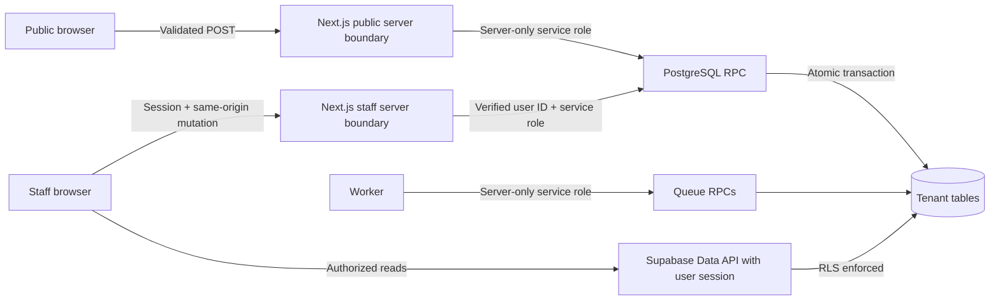
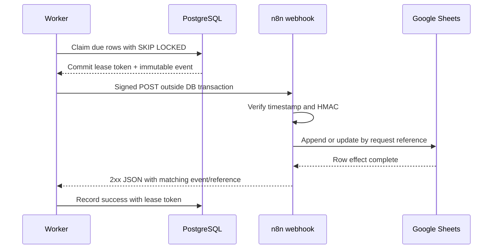
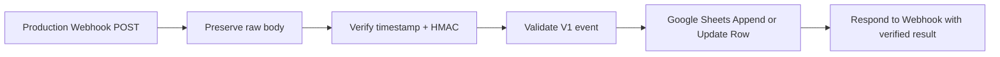

# OpsHub Phase 2B Engineering Design

**Status:** Checkpoint 2B approved by Hazem<br>
**Created:** 2026-10-14<br>
**Approved:** 2026-10-14<br>
**Depends on:** Approved Checkpoint 2A in
[`phase-2a-flows-and-state-machines.md`](phase-2a-flows-and-state-machines.md)<br>
**Authoritative product scope:** [`mvp-spec.md`](../product/mvp-spec.md)<br>
**Implementation state:** Design only. No SQL migration, application code,
dependency installation, deployment, or external workflow has been created.

## 1. Checkpoint purpose

Checkpoint 2B turns the approved flows and state machines into an engineering
contract that can be tested before implementation begins. It defines:

1. The exact logical PostgreSQL schema and important constraints
2. Tenant ownership and Row Level Security boundaries
3. Server and database function responsibilities
4. Atomic review and final-decision behavior
5. Integration delivery claims, leases, retries, and dead-letter behavior
6. The versioned webhook and HMAC contract
7. The Core MVP testing strategy
8. The architecture decisions that implementation must preserve

This is intentionally not SQL. Names and invariants are fixed here; SQL syntax
and migration ordering belong to the implementation checkpoint.

## 2. Fixed inputs from Checkpoint 2A

These decisions are not reopened in 2B:

- The Core MVP has one fixed bilingual service-request workflow.
- A public requester does not create an account and cannot track a request.
- Staff contact the requester manually after the decision.
- An approver or administrator must start review before deciding.
- `start_review()` is idempotent when the request is already `under_review`.
- Starting review does not assign or reserve the request.
- Any eligible member of the approver pool may make the first final decision.
- The first committed approval or rejection wins.
- Rejection requires a reason; free-form internal comments are deferred.
- Approval creates one durable integration delivery atomically.
- Request state and delivery state remain separate.
- Delivery is at least once, with an idempotent external effect.
- Public P0 abuse protection is a honeypot plus PostgreSQL-backed rate limiting.
- Google Sheets is a destination, not the system of record.
- AI does not participate in any Core MVP decision or required action.

## 3. Engineering invariants

The implementation must make these statements true even if the UI is stale,
two users act concurrently, or an external service times out:

1. A browser never chooses or supplies the authoritative `org_id`.
2. A public form identifier resolves to one active organization on the server.
3. The same submission idempotency key creates at most one request per form.
4. A different idempotency key creates a distinct request, even for identical
   content.
5. A request has exactly one immutable submission snapshot.
6. Company-only values are null for an individual request, even if a malicious
   client sends them.
7. A final decision exists only for a request that reached `under_review`.
8. A request has at most one final decision.
9. An approved request has exactly one Core MVP integration delivery.
10. A rejected request has no integration delivery.
11. A delivery failure never changes an approved request back to another state.
12. Audit events are append-only through application permissions.
13. No database transaction remains open during an HTTP call.
14. A worker can finalize an attempt only while holding its current lease token.
15. Retrying may repeat a webhook call, so the receiver must upsert by the
    stable request reference.
16. Secrets, HMAC material, session values, raw request bodies, and full
    external responses never enter logs or audit metadata.

## 4. PostgreSQL conventions

### 4.1 Identity and time

- Externally exposed domain rows use UUID primary keys generated by the server.
- `audit_events` may use a `bigint` identity primary key because its identifier
  is internal and ordered timeline pagination benefits from it.
- Business timestamps use `timestamptz` and are written by the database.
- `desired_start_date` uses `date` because it has no time-of-day meaning.
- Every tenant-owned table carries a non-null `org_id` foreign key.
- Foreign-key columns used in joins or authorization checks receive indexes.

### 4.2 Stable values

Stored values are language-neutral and constrained. Arabic and English labels
remain application configuration.

| Concept | Allowed stored values |
|---|---|
| Member role | `approver`, `admin` |
| Requester type | `individual`, `company` |
| Submitted locale | `ar`, `en` |
| Preferred contact | `email`, `phone`, or null |
| Request status | `submitted`, `under_review`, `approved`, `rejected` |
| Decision | `approved`, `rejected` |
| Delivery status | `pending`, `processing`, `succeeded`, `failed`, `dead` |
| Service category | `consulting`, `it_software`, `marketing`, `training`, `support_maintenance`, `other` |

For the small fixed Core MVP sets, SQL check constraints are preferred over
PostgreSQL enum types. They are easier to evolve through reviewed migrations
without coupling application releases to enum alteration behavior.

### 4.3 Public confirmation reference

- Format: exactly 10 Crockford Base32 characters.
- Alphabet: `0-9` and uppercase letters excluding `I`, `L`, `O`, and `U`.
- Generation: cryptographically secure random bytes encoded and truncated or
  rejection-sampled to the allowed alphabet.
- Constraint: globally unique.
- Property: non-sequential and volume-hiding.
- Security meaning: it is a reference, not a password or access token.

Ten Crockford Base32 characters provide 50 bits of namespace. A uniqueness
constraint handles the very unlikely collision by regenerating and retrying.

## 5. Logical schema

### 5.1 Core table count

The Core MVP has **10 product-domain tables**:

1. `organizations`
2. `profiles`
3. `organization_members`
4. `public_forms`
5. `requests`
6. `request_submission_snapshots`
7. `approval_decisions`
8. `audit_events`
9. `integration_deliveries`
10. `webhook_endpoints`

PostgreSQL-backed rate limiting requires one additional private operational
table, `private.public_submission_rate_limits`. It is not a product-domain
table, is not exposed through the Data API, and stores no raw IP addresses.
Calling the entire database a 10-table database would therefore be inaccurate.

### 5.2 `organizations`

Purpose: tenant root and organization defaults.

| Column | Type | Required | Rule |
|---|---|---:|---|
| `id` | `uuid` | yes | Primary key |
| `name` | `text` | yes | Trimmed, 2 to 120 characters |
| `default_locale` | `text` | yes | `ar` or `en` |
| `timezone` | `text` | yes | Valid PostgreSQL timezone name; initial seed `Africa/Cairo` |
| `is_active` | `boolean` | yes | Defaults true |
| `created_at` | `timestamptz` | yes | Database timestamp |
| `updated_at` | `timestamptz` | yes | Database-maintained |

Important indexes and constraints:

- Primary key on `id`
- Validation of timezone occurs through controlled setup logic because a check
  constraint cannot query `pg_timezone_names`
- No public or ordinary staff insert/delete path in P0

### 5.3 `profiles`

Purpose: application profile for a Supabase Auth user.

| Column | Type | Required | Rule |
|---|---|---:|---|
| `user_id` | `uuid` | yes | Primary key and foreign key to `auth.users.id` |
| `display_name` | `text` | yes | Trimmed, 2 to 120 Unicode characters |
| `preferred_locale` | `text` | yes | `ar` or `en` |
| `created_at` | `timestamptz` | yes | Database timestamp |
| `updated_at` | `timestamptz` | yes | Database-maintained |

Profiles do not store authorization roles. Roles belong to organization
memberships so one person can have different access in different tenants.

### 5.4 `organization_members`

Purpose: active tenant membership and effective role.

| Column | Type | Required | Rule |
|---|---|---:|---|
| `id` | `uuid` | yes | Primary key |
| `org_id` | `uuid` | yes | Foreign key to `organizations` |
| `user_id` | `uuid` | yes | Foreign key to `profiles.user_id` |
| `role` | `text` | yes | `approver` or `admin` |
| `is_active` | `boolean` | yes | Defaults true |
| `created_at` | `timestamptz` | yes | Database timestamp |
| `updated_at` | `timestamptz` | yes | Database-maintained |

Important indexes and constraints:

- Unique `(org_id, user_id)`
- Index `(user_id, is_active, org_id)` for membership checks
- Index `(org_id, role, is_active)` for role checks and staff listing
- `admin` includes approver capability in authorization logic
- Membership changes are seeded or administratively managed outside the P0 UI

### 5.5 `public_forms`

Purpose: maps a high-entropy public URL identifier to an organization and the
fixed form version.

| Column | Type | Required | Rule |
|---|---|---:|---|
| `id` | `uuid` | yes | Internal primary key |
| `org_id` | `uuid` | yes | Foreign key to `organizations` |
| `public_id` | `text` | yes | High-entropy, URL-safe, globally unique |
| `form_version` | `integer` | yes | Positive, starts at 1 |
| `consent_text_version_ar` | `text` | yes | Version identifier, not the full text |
| `consent_text_version_en` | `text` | yes | Version identifier, not the full text |
| `is_active` | `boolean` | yes | Disabled forms reject new submissions |
| `created_at` | `timestamptz` | yes | Database timestamp |
| `updated_at` | `timestamptz` | yes | Database-maintained |

Important indexes and constraints:

- Unique `public_id`
- Index `(org_id, is_active)`
- The public client may send `public_id`; the server resolves `org_id`
- P0 has one active form per seeded organization, enforced by setup rather than
  a permanent uniqueness rule that would block future multiple forms

### 5.6 `requests`

Purpose: operational workflow record. Requester content lives in the one-to-one
snapshot rather than being duplicated here.

| Column | Type | Required | Rule |
|---|---|---:|---|
| `id` | `uuid` | yes | Primary key |
| `org_id` | `uuid` | yes | Tenant foreign key |
| `public_form_id` | `uuid` | yes | Foreign key to `public_forms` |
| `reference` | `text` | yes | 10-character Crockford Base32, globally unique |
| `idempotency_key` | `uuid` | yes | Generated once by the public client |
| `status` | `text` | yes | Request status value |
| `submitted_at` | `timestamptz` | yes | Set at successful transaction |
| `review_started_at` | `timestamptz` | no | Set once on first Start Review |
| `decided_at` | `timestamptz` | no | Set once on final decision |
| `created_at` | `timestamptz` | yes | Same transaction as submission |
| `updated_at` | `timestamptz` | yes | Database-maintained |

Important indexes and constraints:

- Unique `reference`
- Unique `(public_form_id, idempotency_key)`
- Index `(org_id, status, submitted_at desc, id desc)` for the staff list
- Index `(org_id, submitted_at desc, id desc)` for unfiltered pagination
- Status/timestamp consistency:
  - `submitted`: no review or decision timestamp
  - `under_review`: review timestamp present, decision timestamp absent
  - final: both timestamps present
- `org_id` must match the resolved public form organization. The submission
  function establishes it; an additional composite foreign-key pattern may be
  used in SQL if it remains readable.

### 5.7 `request_submission_snapshots`

Purpose: immutable, typed record of exactly what the requester submitted and
what the server normalized.

| Column | Type | Required | Rule |
|---|---|---:|---|
| `request_id` | `uuid` | yes | Primary key and foreign key to `requests` |
| `org_id` | `uuid` | yes | Tenant foreign key |
| `requester_type` | `text` | yes | `individual` or `company` |
| `contact_name` | `text` | yes | Trimmed and collapsed whitespace, 1 to 120 characters |
| `email` | `text` | yes | Lowercased, trimmed, max 254 characters |
| `phone_raw` | `text` | yes | Trimmed original input, max 64 characters |
| `phone_e164` | `text` | yes | `+` then 2 to 15 digits, first digit non-zero |
| `country_code` | `char(2)` | yes | Uppercase ISO 3166-1 alpha-2 |
| `phone_country_mismatch` | `boolean` | yes | Warning evidence, never an automatic rejection |
| `service_category` | `text` | yes | One fixed category value |
| `request_title` | `text` | yes | Trimmed, 5 to 120 characters |
| `description` | `text` | yes | Trimmed, 20 to 2,000 characters |
| `desired_start_date` | `date` | no | Null or local organization date on/after submission |
| `preferred_contact_method` | `text` | no | `email` or `phone` |
| `submitted_locale` | `text` | yes | `ar` or `en`, derived from the route |
| `consent_text_version` | `text` | yes | Exact displayed-text version identifier |
| `consent_locale` | `text` | yes | `ar` or `en` |
| `consented_at` | `timestamptz` | yes | Server timestamp in the submission transaction |
| `company_name` | `text` | conditional | Required for company, max 160 characters |
| `job_title` | `text` | no | Company only, max 120 characters |
| `company_website` | `text` | no | Company only, normalized HTTP(S), max 2,048 characters |
| `form_version` | `integer` | yes | Version resolved from `public_forms` |
| `created_at` | `timestamptz` | yes | Database timestamp |

Important constraints:

- Exactly one snapshot per request
- No update or delete grant to application roles
- `company` requires a nonblank `company_name`
- `individual` requires `company_name`, `job_title`, and `company_website` all
  to be null
- `company_website` is null or begins with `http://` or `https://`
- The application adds `https://` before validation when a scheme is missing
- No server component ever fetches `company_website`
- Consent locale equals submitted locale in P0
- Desired date is checked inside `submit_request()` using the organization's
  timezone because a stable database check constraint cannot compare it to a
  moving current date safely

### 5.8 `approval_decisions`

Purpose: immutable final decision and actor record.

| Column | Type | Required | Rule |
|---|---|---:|---|
| `id` | `uuid` | yes | Primary key |
| `org_id` | `uuid` | yes | Tenant foreign key |
| `request_id` | `uuid` | yes | Foreign key to `requests` |
| `decision` | `text` | yes | `approved` or `rejected` |
| `reason` | `text` | conditional | Required only for rejection, 5 to 500 characters |
| `decided_by` | `uuid` | yes | Foreign key to `profiles.user_id` |
| `actor_role` | `text` | yes | Role at decision time: `approver` or `admin` |
| `created_at` | `timestamptz` | yes | Database decision timestamp |

Important indexes and constraints:

- Unique `request_id` is the final database guard for first-decision-wins
- Rejection requires a trimmed reason; approval requires `reason` to be null
- No application update or delete path
- Index `(org_id, created_at desc)` for organization audit queries

### 5.9 `audit_events`

Purpose: append-only business and delivery timeline.

| Column | Type | Required | Rule |
|---|---|---:|---|
| `id` | `bigint identity` | yes | Primary key |
| `org_id` | `uuid` | yes | Tenant foreign key |
| `request_id` | `uuid` | no | Required for request-related events |
| `delivery_id` | `uuid` | no | Required for delivery-related events |
| `event_type` | `text` | yes | Fixed event value |
| `actor_type` | `text` | yes | `public_requester`, `staff_user`, `worker`, or `system` |
| `actor_user_id` | `uuid` | no | Present only for a staff user |
| `actor_role` | `text` | no | Role snapshot for staff action |
| `metadata` | `jsonb` | yes | Defaults to empty object, allowlisted safe keys only |
| `created_at` | `timestamptz` | yes | Database timestamp |

P0 event values:

- `request_submitted`
- `review_started`
- `request_approved`
- `request_rejected`
- `job_created`
- `delivery_attempt_started`
- `delivery_succeeded`
- `delivery_failed`
- `delivery_dead`
- `manual_retry`

Important indexes and constraints:

- Index `(org_id, request_id, created_at, id)` for a stable timeline
- Index `(org_id, delivery_id, created_at, id)` for delivery diagnostics
- At least one of `request_id` or `delivery_id` is present
- Metadata may contain safe items such as attempt number, HTTP status class,
  receiver result code, duration, or failure category
- Metadata must not contain requester content, headers, secrets, signatures,
  raw payloads, raw response bodies, stack traces, or raw IP addresses
- No update or delete grant to application roles

Attempt history stays in this table. A separate delivery-attempt table is not
needed for P0 because the audit event plus current delivery row gives enough
evidence for the UI, tests, and portfolio demonstration.

### 5.10 `integration_deliveries`

Purpose: transactional outbox, durable queue item, lease record, and current
delivery summary for the single P0 destination.

| Column | Type | Required | Rule |
|---|---|---:|---|
| `id` | `uuid` | yes | Primary key and outbound event ID |
| `org_id` | `uuid` | yes | Tenant foreign key |
| `request_id` | `uuid` | yes | Foreign key to approved request |
| `webhook_endpoint_id` | `uuid` | yes | Foreign key to endpoint |
| `event_type` | `text` | yes | `request.approved` |
| `event_version` | `integer` | yes | Starts at 1 |
| `idempotency_key` | `text` | yes | Stable for this logical event |
| `payload` | `jsonb` | yes | Immutable validated payload |
| `status` | `text` | yes | Delivery status value |
| `available_at` | `timestamptz` | yes | Earliest claim time |
| `attempt_count` | `integer` | yes | Starts at 0, increments on each claim |
| `max_attempts` | `integer` | yes | Starts at 5; manual retry adds one |
| `locked_at` | `timestamptz` | no | Current claim time |
| `locked_until` | `timestamptz` | no | Current lease expiry |
| `lock_token` | `uuid` | no | New unpredictable value for each claim |
| `locked_by` | `text` | no | Worker instance identifier, max 120 characters |
| `last_http_status` | `integer` | no | Safe numeric status only |
| `last_error_code` | `text` | no | Allowlisted category, max 80 characters |
| `last_error_message` | `text` | no | Sanitized, max 300 characters |
| `last_attempt_at` | `timestamptz` | no | Set on claim |
| `succeeded_at` | `timestamptz` | no | Set once on valid receiver result |
| `created_at` | `timestamptz` | yes | Same transaction as approval |
| `updated_at` | `timestamptz` | yes | Database-maintained |

Important indexes and constraints:

- Unique `request_id` for the single P0 destination
- Unique `idempotency_key`
- Partial claim index `(available_at, created_at, id)` where status is
  `pending` or `failed`
- Partial expired-lease index `(locked_until, id)` where status is `processing`
- Index `(org_id, status, updated_at desc)` for the admin delivery screen
- `attempt_count >= 0`, `max_attempts >= 1`, and `attempt_count <= max_attempts`
- `processing` requires all lease fields; non-processing rows have no active
  lock token or worker owner
- `succeeded` requires `succeeded_at`; other states do not
- `payload`, `event_type`, `event_version`, `request_id`, endpoint, and
  idempotency key are immutable after insert

### 5.11 `webhook_endpoints`

Purpose: controlled destination configuration without storing secret values.

| Column | Type | Required | Rule |
|---|---|---:|---|
| `id` | `uuid` | yes | Primary key |
| `org_id` | `uuid` | yes | Tenant foreign key |
| `name` | `text` | yes | Display name, 2 to 120 characters |
| `destination_type` | `text` | yes | `n8n_google_sheets` in P0 |
| `url` | `text` | yes | HTTPS in production; exact configured endpoint |
| `signing_secret_ref` | `text` | yes | Environment-secret name or version, never the secret |
| `is_active` | `boolean` | yes | Disabled endpoints receive no new delivery |
| `created_at` | `timestamptz` | yes | Database timestamp |
| `updated_at` | `timestamptz` | yes | Database-maintained |

Important indexes and constraints:

- Unique `(org_id, destination_type)` for the one P0 destination
- Index `(org_id, is_active)`
- No P0 browser UI changes URLs or secret references
- The worker accepts only an endpoint created through migration or trusted setup
- Production validates HTTPS, an explicit hostname allowlist, DNS results, no
  private/link-local/metadata targets, strict timeout, and no redirects
- Local development may explicitly allow the Docker n8n hostname; that
  exception is never enabled in production

### 5.12 `private.public_submission_rate_limits`

Purpose: database-backed fixed-window counters for public submissions.

| Column | Type | Required | Rule |
|---|---|---:|---|
| `public_form_id` | `uuid` | yes | Part of primary key |
| `subject_hash` | `bytea` | yes | HMAC of normalized IP with a server-only key |
| `window_started_at` | `timestamptz` | yes | Truncated bucket start |
| `request_count` | `integer` | yes | Positive counter |
| `expires_at` | `timestamptz` | yes | Cleanup boundary |

Rules:

- Composite primary key `(public_form_id, subject_hash, window_started_at)`
- The server never stores a raw IP address
- The HMAC key stays outside PostgreSQL and outside client code
- One atomic upsert increments and evaluates the limit
- Expired buckets are deleted by a maintenance task
- No `anon` or `authenticated` schema usage, table privilege, or Data API path
- Initial proposed limit: 5 submission attempts per 15 minutes per form and
  subject hash, with a second coarse per-form ceiling added if abuse testing
  justifies it

The rate limiter reduces abuse but is not a legal or fraud identity system.
Proxy-derived client IP is trusted only from the configured hosting platform.

### 5.13 Cross-tenant referential integrity

RLS controls who may access a row, but foreign keys must also prevent a child
row from combining identifiers from different organizations. The SQL design
therefore gives each parent a unique `(id, org_id)` key and uses composite
foreign keys where tenant-owned rows connect:

- Request to public form: `(public_form_id, org_id)`
- Snapshot to request: `(request_id, org_id)`
- Decision to request: `(request_id, org_id)`
- Audit event to request and delivery when present
- Delivery to request and webhook endpoint

This makes an inconsistent cross-tenant relationship fail at the database
boundary even when application code or a privileged caller is wrong.

## 6. Access model and RLS

### 6.1 Request path model



The public browser never writes directly to Supabase. Staff mutations also pass
through the Next.js server boundary. This lets the database RPCs remain
`security invoker` and callable only by `service_role`, avoiding exposed
`security definer` functions. The server verifies the Supabase session before
passing the actor user ID, and each staff RPC independently checks active
membership and role.

### 6.2 Database privilege baseline

- Enable RLS on every tenant-owned table in the exposed schema.
- Revoke all unintended table privileges from `anon` and `authenticated`.
- Grant `authenticated` only the exact read operations used by the staff UI.
- Grant no tenant-table privileges to `anon`.
- Keep `service_role` exclusively in server and worker environments.
- Revoke function execution from `PUBLIC`, `anon`, and `authenticated` unless a
  named function is deliberately designed for one of those roles.
- Grant the mutation and worker RPCs only to `service_role`.
- Set `search_path = ''` on every function and schema-qualify every object.
- Prefer `security invoker` for all mutation and worker functions. The one
  pre-approved `security definer` use is a private RLS membership helper when
  needed to avoid policy recursion. Any other use requires a new security
  review before implementation.

### 6.3 Membership helpers

RLS read policies use private stable helpers such as:

- `private.is_active_org_member(org_id)`
- `private.has_org_role(org_id, allowed_roles[])`

When these helpers need to bypass membership-table RLS to avoid policy
recursion, they are `security definer` functions in a private, non-exposed
schema. They use `(select auth.uid())`, live membership rows, a pinned empty
search path, schema-qualified tables, and narrow execute grants to
`authenticated`. They return only the caller-scoped boolean and never expose
membership rows. They never trust a role copied only from client state or an
editable profile.

### 6.4 RLS policy matrix

| Table | Anonymous | Authenticated approver | Authenticated admin | Direct client writes |
|---|---|---|---|---|
| `organizations` | none | Select own active organization | Select own active organization | none in P0 |
| `profiles` | none | Select/update own safe profile fields | Same as approver | Own locale/display-name update only if implemented |
| `organization_members` | none | Select own active memberships | Select active memberships in own organization | none in P0 |
| `public_forms` | none | Select forms in own organization | Same as approver | none in P0 |
| `requests` | none | Select own-organization requests | Same as approver | none; mutations use server RPC |
| `request_submission_snapshots` | none | Select snapshots for own-organization requests | Same as approver | none |
| `approval_decisions` | none | Select own-organization decisions | Same as approver | none |
| `audit_events` | none | Select own-organization request timeline | Select own-organization request and delivery timeline | none |
| `integration_deliveries` | none | No direct table access | Select own-organization deliveries | none |
| `webhook_endpoints` | none | none | Select safe configuration fields for own organization | none in P0 |

Safe endpoint reads must not return a future encrypted secret or credential. The
secret reference may be omitted from the client-facing projection entirely.
Admin delivery reads use column-level grants or a safe projection that excludes
the immutable payload, lock token, destination URL, and secret reference.

### 6.5 Isolation behavior

- A user with no active membership receives no tenant rows.
- A valid user in organization A receives no rows from organization B.
- An approver cannot access the failed-delivery administration table.
- An admin may approve because admin includes approver capability.
- Deactivating membership takes effect on the next database operation because
  authorization reads the live membership table.
- Resource lookup may return a generic not-found result for cross-tenant IDs to
  avoid confirming that the resource exists.

## 7. RPC and server boundary contracts

All mutation functions are transactional, use typed parameters, return a small
typed result, and expose no raw database error to the browser.

### 7.1 `submit_request()`

Caller: trusted Next.js public submission handler using `service_role`.

Server boundary responsibilities before the RPC:

1. Enforce a small request-body limit, proposed at 32 KB.
2. Validate the locale route and idempotency-key UUID.
3. Reject a filled honeypot with a generic response.
4. Normalize and validate all runtime input with the shared schema.
5. Normalize Arabic-Indic digits for phone parsing.
6. Normalize phone to E.164 using the selected country as default region.
7. Record, but do not reject, a plausible phone/country mismatch.
8. Add `https://` to a scheme-less company website and reject non-HTTP(S).
9. Drop all company-only fields for an individual.
10. Check and increment the database-backed rate limit.
11. Call the RPC with the public form ID, normalized input, and no `org_id`.

Atomic database responsibilities:

1. Resolve and lock the active public form and organization.
2. Return the original successful result when the form/idempotency pair exists.
3. Validate the form version, consent version, locale, organization timezone,
   desired date, and company branch again.
4. Generate a unique public reference.
5. Insert `requests` in `submitted` state.
6. Insert exactly one immutable snapshot.
7. Insert `request_submitted` audit event.
8. Commit all three records or none.
9. Return `{request_id, reference, status, replayed}`.

Expected HTTP mapping:

- New success: `201 Created`
- Idempotent replay: `200 OK` with the original reference
- Invalid input: `422 Unprocessable Content`
- Disabled or unknown form: generic `404 Not Found`
- Rate limit: `429 Too Many Requests` with safe retry guidance
- Temporary internal failure: generic `503 Service Unavailable`

### 7.2 `start_review(request_id, actor_user_id)`

Caller: trusted Next.js staff mutation boundary after session verification.

Atomic behavior:

1. Lock the request row.
2. Verify active actor membership in the request organization.
3. Accept role `approver` or `admin`.
4. If state is `submitted`, set `under_review`, set `review_started_at`, and
   append one `review_started` event.
5. If state is already `under_review`, return the current state with
   `transitioned: false`; do not add a duplicate event.
6. If state is final, return a conflict.

Result: `{request_id, status, transitioned, review_started_at}`.

### 7.3 `decide_request(request_id, actor_user_id, decision, reason)`

Caller: trusted Next.js staff mutation boundary after session verification.

Atomic behavior:

1. Lock the request row.
2. Verify active membership and approver capability.
3. Require current status `under_review`.
4. Validate decision and conditional rejection reason.
5. Insert the unique approval decision.
6. Update request to `approved` or `rejected` and set `decided_at`.
7. Append the corresponding request audit event with actor and role.
8. For approval only, resolve the active P0 endpoint, create exactly one
   `pending` integration delivery with immutable V1 payload, and append
   `job_created`.
9. Commit all effects or none.

Concurrent final decisions serialize on the locked request. The winner commits;
the loser re-reads a final state and receives `409 Conflict` with enough data to
refresh the view, but without modifying the winner's result.

### 7.4 `manual_retry(delivery_id, actor_user_id)`

Caller: trusted Next.js admin mutation boundary.

Atomic behavior:

1. Lock the delivery row.
2. Verify active admin membership in the same organization.
3. Allow only `failed` or `dead`.
4. Set status to `pending` and `available_at` to now.
5. Clear stale lease fields and last transient error fields.
6. Increment `max_attempts` by exactly one; never reset `attempt_count`.
7. Append `manual_retry` with actor, role, and the newly allowed attempt number.

This action schedules work. It never makes the webhook call in the browser
request.

### 7.5 Worker-only queue functions

`claim_integration_deliveries(batch_size, worker_id, lease_seconds)`:

- Accept a bounded batch size, proposed range 1 to 20.
- Before claiming, move expired `processing` rows with no remaining attempt
  budget to `dead` and append `delivery_dead`.
- Claim due `pending` or `failed` rows and expired `processing` rows only when
  `attempt_count < max_attempts`.
- Use `FOR UPDATE SKIP LOCKED` inside a short transaction.
- Set `processing`, generate a new `lock_token`, set lease times and worker ID,
  increment `attempt_count`, and append `delivery_attempt_started`.
- Return only the claimed ID, stable payload, endpoint data required to send,
  attempt number, lease token, and signature-secret reference.
- Commit before any network call.

`record_delivery_success(delivery_id, lock_token, result)`:

- Lock the delivery and require matching token, `processing`, and unexpired
  lease ownership.
- Validate `2xx`, `ok: true`, and matching event/reference response values.
- Mark `succeeded`, clear the lease, store only safe response metadata, and
  append `delivery_succeeded`.

`record_delivery_failure(delivery_id, lock_token, failure)`:

- Lock the delivery and require the matching active token.
- Sanitize and classify the failure.
- If `attempt_count >= max_attempts`, mark `dead` and append `delivery_dead`.
- Otherwise mark `failed`, calculate the next `available_at`, and append
  `delivery_failed`.
- Clear lease ownership in both cases.

A late worker with an old token cannot overwrite a newer attempt's result.

### 7.6 Browser request protections

- Staff mutations use POST and verify the current session on the server.
- Cookie-authenticated mutations use Next.js Server Action origin checks or an
  equivalent strict same-origin and CSRF defense in Route Handlers.
- No authorization decision relies on hidden buttons or client route guards.
- Tenant responses are dynamic/private and never enter a shared cache.
- Runtime schemas validate all untrusted values; TypeScript types alone are not
  treated as validation.
- Client errors are generic. Structured server logs use redaction and stable
  error codes.

## 8. Delivery worker design

### 8.1 Claim and send sequence



### 8.2 Proposed P0 timing defaults

| Setting | Proposed value | Reason |
|---|---:|---|
| Automatic attempt limit | 5 | Demonstrates recovery without endless retries |
| Lease duration | 60 seconds | Longer than the HTTP timeout with cleanup margin |
| HTTP timeout | 15 seconds | Prevents a stuck receiver from occupying the worker |
| Initial backoff ceiling | 30 seconds | Quick recovery for a brief local failure |
| Maximum backoff ceiling | 30 minutes | Prevents tight retry loops |
| HMAC timestamp tolerance | 5 minutes | Limits replay age while allowing clock skew |
| Worker batch size | 10 | Small, observable Core MVP batches |

Automatic delay uses capped exponential backoff with full jitter:

```text
ceiling = min(30 minutes, 30 seconds * 2^(attempt_count - 1))
delay   = random value from 0 through ceiling
```

The exact chosen delay is written to `available_at`. Tests use an injected
random source or deterministic override so they do not become flaky.

### 8.3 Failure classification

Retryable examples:

- Network timeout or connection reset
- DNS failure judged transient
- HTTP `408`, `425`, `429`, or `5xx`
- Valid n8n error result explicitly marked retryable

Non-retryable examples:

- Invalid configured destination
- TLS or hostname policy violation
- HTTP `400`, `401`, `403`, `404`, or `422`
- Invalid receiver JSON or mismatched event/reference
- HMAC configuration error

Both classes consume the current attempt. Non-retryable failures move directly
to `dead` because repeating them automatically cannot repair configuration or
contract errors. An administrator can fix configuration outside the P0 UI and
then grant one manual retry.

### 8.4 Crash and uncertainty behavior

- Crash before claim commit: no row was claimed.
- Crash after claim commit but before send: lease expires and another worker
  claims a new attempt.
- Timeout after n8n completed the Sheets effect: retry repeats the event, and
  n8n upserts the same row by request reference.
- Crash after receiving success but before recording it: same as an uncertain
  timeout; receiver idempotency prevents a duplicate row.
- Old worker returns after lease replacement: its stale token is rejected.

This is why the product claim is **at-least-once delivery with an idempotent
external effect**, never distributed exactly once.

## 9. Webhook contract V1

### 9.1 Request

Method: `POST`<br>
Content type: `application/json; charset=utf-8`<br>
Event type: `request.approved`<br>
Event version: `1`

Required headers:

| Header | Value |
|---|---|
| `Content-Type` | `application/json; charset=utf-8` |
| `X-OpsHub-Event-Id` | Delivery UUID |
| `X-OpsHub-Timestamp` | Unix time in whole seconds at send attempt |
| `X-OpsHub-Signature` | `v1=<lowercase hex HMAC-SHA256>` |
| `Idempotency-Key` | Stable logical-event key |

Canonical signing input:

```text
UTF8(timestamp + "." + exact_raw_request_body_bytes)
```

Signature:

```text
v1=hex(HMAC-SHA256(secret, signing_input))
```

Receiver rules:

1. Read and preserve the raw body before JSON parsing.
2. Require all signature headers.
3. Reject a timestamp outside the configured tolerance.
4. Compute the signature over the exact raw bytes.
5. Compare signatures using a constant-time comparison.
6. Parse and validate the JSON only after signature success.
7. Require the header event ID to equal the body event ID.
8. Treat repeated valid events as idempotent upserts.

### 9.2 Immutable payload

```json
{
  "event_id": "uuid",
  "event_type": "request.approved",
  "event_version": 1,
  "occurred_at": "2026-10-14T12:00:00.000Z",
  "request": {
    "reference": "7K3M9Q2R8D",
    "submitted_at": "2026-10-14T11:30:00.000Z",
    "approved_at": "2026-10-14T12:00:00.000Z",
    "submitted_locale": "ar",
    "requester_type": "company",
    "contact_name": "Synthetic Demo User",
    "email": "demo@example.test",
    "phone_e164": "+201000000000",
    "country_code": "EG",
    "preferred_contact_method": "email",
    "company_name": "Synthetic Demo Company",
    "job_title": "Operations Manager",
    "company_website": "https://example.test",
    "service_category": "it_software",
    "request_title": "Synthetic service request",
    "description": "Synthetic portfolio demonstration data only.",
    "desired_start_date": "2026-10-20"
  }
}
```

Rules:

- Optional values are JSON `null`, not omitted inconsistently.
- Payload keys and enum values remain English and language-neutral.
- The full consent record, raw phone input, mismatch flag, audit details,
  internal IDs, rejection data, and staff identity are not sent to Sheets.
- The payload is created at approval and remains unchanged across retries.
- The send-attempt timestamp header changes on each attempt; the payload does
  not.
- Only synthetic data is used in the public portfolio demonstration.

### 9.3 n8n workflow



Configuration rules:

- Use the production webhook URL for worker configuration.
- Enable raw-body access.
- The verification step runs before any Google credential or Sheets node.
- Google Sheets uses **Append or Update Row**, matching the unique request
  reference column.
- The response node executes only after the Sheets operation succeeds.
- n8n credentials and HMAC secret remain in n8n credential/environment storage,
  never in exported workflow JSON.
- Disable execution-data retention or redact payloads for a real client setup;
  the portfolio demo uses synthetic data only.

### 9.4 Success response

```json
{
  "ok": true,
  "event_id": "uuid",
  "request_reference": "7K3M9Q2R8D",
  "effect": "upserted"
}
```

The worker accepts success only when the HTTP status is `2xx`, `ok` is true,
and the returned event ID and request reference match the delivery. A bare `200`
or malformed response is a contract failure.

## 10. Error boundaries and observable data

| Boundary | User-facing result | Stored evidence |
|---|---|---|
| Public validation | Field-specific safe message | No audit event before valid submission |
| Honeypot/rate limit | Generic retry guidance | Counter only; no raw IP |
| Staff unauthenticated | Sign-in or `401` | Standard redacted security log |
| Staff unauthorized/cross-tenant | Generic forbidden or not found | Stable error code, no target data |
| Concurrent final decision | Refresh with winner's final state | One decision and one final audit event |
| Worker transient failure | Scheduled retry | Category, attempt, safe message, next time |
| Worker permanent failure | Dead state for admin | Safe category and timeline event |
| n8n contract mismatch | Retry or dead by class | Status and safe receiver code only |

The staff request timeline shows `job_created`, `delivery_succeeded`,
`delivery_failed`, and `manual_retry`. Detailed worker-only attempt entries may
appear on the admin delivery screen while the request timeline groups noisy
attempts into readable business events.

## 11. Test strategy

### 11.1 Test layers

| Layer | Main responsibility |
|---|---|
| Unit | Normalization, validation, reference generation, signature helpers, backoff, failure classification |
| Database constraint | Invalid rows fail even if application validation is bypassed |
| Database RPC | Transactions, idempotency, row locks, state transitions, and audit effects |
| RLS/privilege | Positive same-tenant reads and negative anonymous/cross-tenant/direct-write cases |
| Worker integration | Claim concurrency, leases, retries, stale tokens, and response validation |
| n8n contract | Raw-body signature verification, Sheets upsert, and response ordering |
| Playwright E2E | Arabic/English requester and staff journeys, failures, and accessibility |

### 11.2 Submission tests

- Arabic and English valid submissions succeed.
- Arabic-Indic phone digits normalize to the expected E.164 value.
- Valid phone/country mismatch stores a warning but succeeds.
- Individual submission drops injected company fields server-side.
- Company submission requires company name.
- Job title and website are rejected for an individual at the database boundary.
- Missing website scheme becomes `https://`; non-HTTP(S) schemes fail.
- Website is never fetched.
- Desired date before the organization's local submission date fails.
- Consent version, locale, and server timestamp are stored.
- Same idempotency key under concurrency creates one request and returns one
  reference to both callers.
- Different keys with identical content create two requests.
- Unknown/disabled form returns a generic result and creates nothing.
- Filled honeypot and exceeded rate limit create nothing.

### 11.3 Review and concurrency tests

- Opening detail does not change status.
- First Start Review transitions and creates one audit event.
- Repeated or concurrent Start Review calls return `under_review` without a
  duplicate audit event.
- Direct decision from `submitted` fails.
- Approval reason is null; rejection reason is required and bounded.
- Approver and admin may decide; inactive member and non-member may not.
- Two concurrent final decisions produce exactly one decision row.
- Winning approval creates one delivery and two related audit events in the
  same transaction.
- Losing final decision creates no side effect.
- Rejection creates no delivery.

### 11.4 RLS and privilege tests

- `anon` cannot select or mutate any tenant table or call any RPC.
- Authenticated user with no membership reads no tenant rows.
- Organization A cannot read organization B rows by list, direct ID, join, or
  guessed reference.
- Approver reads request data but not integration-delivery rows.
- Admin reads own-organization deliveries but not another organization's.
- Neither approver nor admin can directly insert/update/delete workflow rows.
- `authenticated` cannot execute service-role RPCs.
- Private membership helpers return only the caller's authorized result.
- Deactivated membership loses access immediately.

### 11.5 Worker and integration tests

- Two workers claiming concurrently never receive the same active lease.
- Claim transaction commits before the mock HTTP receiver is called.
- Attempt count increments once per successful claim.
- Expired processing lease can be reclaimed with a new token.
- Old token cannot record success or failure.
- Valid signed request produces exactly one Sheets row.
- Repeated event updates that row rather than appending another.
- Missing, malformed, stale, or incorrect signature is rejected before Sheets.
- Timeout and retryable status schedule backoff.
- Permanent contract/configuration error moves directly to dead.
- Fifth failed automatic attempt reaches dead with default settings.
- Admin manual retry grants exactly one new attempt and preserves history.
- Approver manual retry is denied.
- Valid success response marks succeeded and becomes non-retryable.
- A `2xx` with mismatched identifiers is not accepted as success.

### 11.6 E2E journeys

1. Arabic individual request through approval and successful Sheets upsert
2. English company request through rejection with required reason
3. Two approvers start review, then compete for one final decision
4. Approved request fails delivery, reaches admin page, and recovers by retry
5. Cross-tenant direct navigation and mutation attempts fail
6. Mobile Arabic form verifies RTL, mixed-direction content, keyboard focus,
   validation summary, and confirmation reference readability

### 11.7 Implementation gate

The migration checkpoint is not complete until automated tests demonstrate:

- Constraint enforcement
- Atomic RPC rollback
- Idempotency under concurrency
- First-final-decision-wins under concurrency
- Cross-tenant negative access
- Queue claim exclusivity and stale-token rejection

The project checkpoint is not complete until the full synthetic E2E flow also
passes in Arabic and English.

## 12. Architecture decision records

### ADR-001: Linear request state machine

Decision: require `submitted -> under_review -> approved|rejected`.

Reason: creates an observable start-review action and prevents accidental
one-click final decisions.

### ADR-002: Non-exclusive approval pool

Decision: Start Review changes state but creates no assignment lock.

Reason: fits small teams while the database uniqueness rule makes the first
final decision authoritative.

### ADR-003: Server-mediated mutations with atomic PostgreSQL functions

Decision: public and staff mutations pass through trusted Next.js server
boundaries and service-role-only, security-invoker database functions.

Reason: preserves transaction safety, avoids exposing privileged functions,
and keeps session, CSRF, validation, and error translation in one server layer.

### ADR-004: RLS plus least-privilege grants for reads

Decision: every exposed tenant table uses RLS, explicit grants, and negative
cross-tenant tests even though server mutations also authorize explicitly.

Reason: defense in depth for Data API reads and future application changes.

### ADR-005: One delivery table for outbox and queue

Decision: `integration_deliveries` is both the transactional outbox record and
the current job state.

Reason: the Core MVP has one event and one destination, so separate outbox and
job tables would add coordination without useful behavior.

### ADR-006: At-least-once delivery, idempotent external effect

Decision: leases and retries may resend; n8n upserts by stable request reference.

Reason: a timeout cannot prove whether the external effect occurred. Claiming
exactly once across PostgreSQL, HTTP, n8n, and Sheets would be false.

### ADR-007: Environment-held signing secret

Decision: database configuration stores a secret reference, not secret bytes.
The worker and n8n receive the P0 secret through server-only environments.

Reason: prevents credential disclosure through database reads, exports, logs,
or browser bundles. Per-organization secret vaulting remains a later feature.

### ADR-008: Attempt history in append-only audit events

Decision: use `audit_events` for attempt history rather than a separate attempts
table in P0.

Reason: it preserves observable history while keeping the product domain at 10
tables. A future high-volume system may split technical attempts into a
dedicated telemetry table.

### ADR-009: Private operational rate-limit table

Decision: add one private anti-abuse table outside the 10 product-domain tables.

Reason: a PostgreSQL-backed rate limiter cannot be honest or concurrent without
durable state. Hiding the table to preserve a marketing table count would leave
the requirement undefined.

### ADR-010: No direct public database submission

Decision: the unauthenticated form posts to a Next.js server boundary.

Reason: it prevents browser-controlled tenant identifiers, keeps service-role
and rate-limit logic server-only, and provides one validation/error boundary.

### ADR-011: Free-form comments and AI remain deferred

Decision: neither comments nor AI participates in Core MVP workflow data.

Reason: rejection reason and audit events satisfy P0 review evidence; AI begins
only after deterministic acceptance criteria pass.

## 13. Security review checklist for implementation

- [ ] No service-role key, signing secret, or secret reference is exposed with
      a `NEXT_PUBLIC_` name or imported into client code.
- [ ] Every state-changing staff route verifies session, same-origin/CSRF, live
      membership, and role.
- [ ] Every untrusted body, parameter, header, and RPC return is validated at
      runtime.
- [ ] Sensitive staff responses use private/no-store caching behavior.
- [ ] No user-provided URL reaches server-side `fetch`.
- [ ] Webhook destination uses an allowlist, timeout, no redirect, and production
      private-network blocking.
- [ ] HMAC verification uses exact raw bytes and constant-time comparison.
- [ ] Logs redact cookies, authorization headers, payloads, requester PII,
      signatures, environment values, and raw external responses.
- [ ] Database functions use empty search paths, qualified names, minimal
      execution grants, and no dynamic SQL from user input.
- [ ] RLS tests cover anonymous, no-membership, inactive, cross-tenant,
      approver, and admin cases.
- [ ] n8n exported workflow contains no Google credential or HMAC secret.
- [ ] Public demo data is synthetic.

## 14. Source basis

This design applies the following primary technical guidance:

- Supabase requires RLS on exposed tables, reminds implementers that grants and
  policies both matter, and identifies `service_role` as server-only:
  <https://supabase.com/docs/guides/database/postgres/row-level-security>
- Supabase recommends security-invoker functions by default, empty search paths,
  qualified names, and explicit function execution grants:
  <https://supabase.com/docs/guides/database/functions>
- PostgreSQL documents `SKIP LOCKED` as appropriate for avoiding contention
  among multiple consumers of a queue-like table:
  <https://www.postgresql.org/docs/current/sql-select.html>
- n8n documents raw-body webhook input, production webhook URLs, controlled
  responses, and Google Sheets Append or Update Row:
  <https://docs.n8n.io/integrations/builtin/core-nodes/n8n-nodes-base.webhook/>
  <https://docs.n8n.io/integrations/builtin/core-nodes/n8n-nodes-base.respondtowebhook/>
  <https://docs.n8n.io/integrations/builtin/app-nodes/n8n-nodes-base.googlesheets/>
- Next.js treats server actions and handlers as security boundaries, requires
  runtime validation and server-side authorization, and warns against exposing
  secrets through public environment variables:
  <https://nextjs.org/blog/security-nextjs-server-components-actions>
  <https://nextjs.org/docs/pages/guides/environment-variables>

These sources support the architecture. They do not replace project-specific
tests.

## 15. Locked Checkpoint 2B decisions

Hazem approved all ten defaults below on 2026-10-14:

| Decision | Recommended answer |
|---|---|
| Core table count wording | 10 product-domain tables plus 1 private operational rate-limit table |
| Automatic delivery attempts | 5 total |
| Lease and HTTP timeout | 60-second lease, 15-second HTTP timeout |
| Backoff | 30-second base ceiling, exponential full jitter, 30-minute cap |
| Manual retry budget | Each confirmed admin retry grants exactly 1 additional attempt |
| HMAC replay tolerance | 5 minutes |
| Attempt history | Store in append-only `audit_events` for P0 |
| Mutation path | Browser -> trusted Next.js server -> service-role-only security-invoker RPC |
| Signing secret | Server/n8n environment secret; database stores only a reference |
| Public rate limit | 5 attempts per 15 minutes per form and HMAC-hashed network subject |

These values are now implementation inputs rather than open questions. The next
checkpoint is Phase 3 foundation planning and migration sequencing.
Implementation should still begin in small reviewed increments, starting with
repository foundation and local reproducibility rather than building the full
workflow at once.

## 16. Phase 3–6 SQL and implementation watchlist

These notes refine how the approved design is implemented. They do not change
the Checkpoint 2B architecture.

### 16.1 Submission idempotency concurrency

Do not lock the shared `public_forms` row for every submission. That would
serialize unrelated requests to the same form.

For `submit_request()`, take a transaction-scoped advisory lock derived from
both `public_form_id` and `idempotency_key`, then check for an existing request
and insert only when none exists. The unique constraint on
`(public_form_id, idempotency_key)` remains the final integrity guard. The SQL
test must send concurrent calls with the same key and prove that both receive
the same committed request, while different keys are not unnecessarily
serialized.

### 16.2 Delivery-success fencing

`record_delivery_success()` must require:

- `status = 'processing'`
- `lock_token = p_lock_token`

It must not reject a matching worker only because `locked_until` passed moments
before the success transaction. The unpredictable lock token is the fencing
authority. If another worker reclaimed the delivery, the token will already be
different, or the row will have moved to `dead`, so the stale worker still
cannot overwrite the newer state.

### 16.3 Safe admin delivery reads

PostgreSQL column-level grants make a Supabase `.select('*')` fail with
`permission denied` when hidden columns such as `payload` and `lock_token` are
excluded.

Implementation must choose one explicit approach and test it:

1. Use explicit safe column lists in every Next.js admin-delivery query, or
2. Expose a purpose-built view using `security_invoker = true` with only the
   safe columns needed by the admin screen.

The implementation checkpoint should prefer the security-invoker view if it
makes the UI contract clearer. Neither approach may expose the immutable
payload, lock token, destination URL, or secret reference.

### 16.4 Nullable audit-event relationships

Keep both tenant-safe composite foreign keys on `audit_events`:

- `(request_id, org_id)` to the request parent key
- `(delivery_id, org_id)` to the delivery parent key

Because each optional identifier may be null and PostgreSQL `MATCH SIMPLE`
does not validate a composite foreign key when one referencing column is null,
also keep the direct non-null foreign key:

```text
audit_events.org_id -> organizations.id
```

Tests must cover request-only events, delivery-only events, events containing
both identifiers, invalid organization IDs, and cross-tenant parent pairs.
