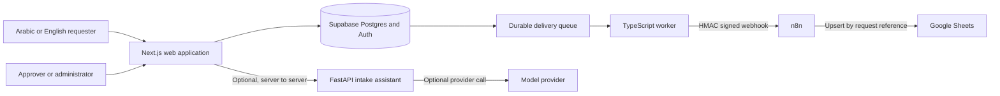

# OpsHub Phase 9 Production Deployment

**Status:** Deployment-ready design; no public environment has been created  
**Reviewed:** 19 October 2026  
**Scope:** Web, Supabase, delivery worker, n8n, Google Sheets, and optional AI

## 1. Production shape

The database is the system of record. Google Sheets is an idempotent external
destination. The optional assistant may propose editable form values, but the
normal form, server validation, workflow state machine, and human approval stay
authoritative.

## 2. Two honest hosting profiles

### Portfolio preview

Use this only for a personal, non-commercial demonstration:

- Next.js on Vercel Hobby
- Supabase Free for Postgres and Auth
- AI disabled or hosted temporarily with a documented cold start
- worker and n8n demonstrated locally, not described as always-on production
- synthetic data only

This is not a complete live service. Vercel documents Hobby as personal and
non-commercial, while Render documents that free web services sleep after 15
minutes of inactivity and have an ephemeral filesystem. Those limitations make
a free, always-on worker and persistent n8n service unsuitable for client use.

### Client-ready service

- a commercial web plan such as Vercel Pro
- an appropriately sized Supabase plan with backups and usage monitoring
- always-on worker hosting such as Railway Hobby or a paid Render worker
- persistent managed n8n Cloud or self-hosted n8n with a persistent volume
- an optional always-on AI service after the live-provider evaluation passes
- custom domain, TLS, uptime monitoring, log retention, and a recovery owner

Railway Hobby currently begins at USD 5 per month with included usage. n8n
Cloud currently begins at EUR 20 per month when billed annually. Actual cost
depends on traffic, execution count, logs, storage, and whether n8n is managed
or self-hosted.

## 3. Environment boundaries

| Component | Public input | Private credentials | Persistent state |
| --- | --- | --- | --- |
| Web | locale, form values, staff browser session | Supabase secret key, submission rate-limit key, AI internal key | none outside Supabase |
| Supabase | authenticated and anonymous API requests | project database and JWT secrets | requests, decisions, audit, deliveries, rate limits |
| Worker | none | Supabase secret key, webhook URL, HMAC secret | delivery state in Supabase |
| n8n | signed OpsHub webhook | n8n encryption key, Google OAuth credential, HMAC secret | workflow and credential store |
| AI service | same-origin web server calls only | AI internal key, optional provider key | no authoritative request state |

Secrets must be unique per environment, held in the hosting secret store, and
rotated after any exposure. Browser-visible variables are limited to the
Supabase URL and publishable key. The Supabase secret key, HMAC secret, Google
credentials, n8n encryption key, AI internal key, and model-provider key must
never enter a client bundle or Git.

## 4. Deployment order

1. Create separate preview and production projects.
2. Configure domains, environment allowlists, and HTTPS-only endpoints.
3. Apply the committed Supabase migrations in order, then run database tests.
4. Create staff accounts and organization memberships through the approved
   administrative path.
5. Deploy n8n with persistent storage, import the versioned workflow, configure
   Google OAuth, and keep the workflow inactive until its HMAC secret is set.
6. Deploy the worker with one instance initially and verify lease acquisition.
7. Deploy the optional AI service with `mock` or `disabled` provider first.
8. Deploy the web application and run the smoke checklist below.
9. Activate n8n and submit one synthetic end-to-end request.
10. Enable the live AI provider only after the provider evaluation gate passes.

## 5. Production safety checks

- Configure the trusted proxy chain before using forwarded client IPs for rate
  limiting. Do not trust arbitrary `X-Forwarded-For` values.
- Restrict the worker webhook to an exact HTTPS origin and keep redirects off.
- Use the same HMAC secret on the worker and n8n only.
- Preserve the raw webhook body for signature verification.
- Use persistent storage for n8n; its credential database cannot live on an
  ephemeral free filesystem.
- Keep at least one tested database backup and document who can restore it.
- Alert on dead deliveries, repeated authentication failures, and service
  readiness failures without logging request bodies or secrets.
- Confirm that staff responses use private `no-store` caching.

## 6. Live smoke and rollback

The public release is accepted only when a synthetic request can be submitted,
reviewed, approved, delivered, and updated in Google Sheets without duplicate
rows. Rejection, concurrent final decisions, manual retry, Arabic RTL, English
LTR, mobile layout, logout, and cross-tenant denial must also pass.

If the web release fails, restore the previous web deployment. If a worker or
n8n release fails, stop that service while preserving pending database jobs,
then restore the previous image or workflow. Database migrations need an
explicit forward repair or a rehearsed rollback; never improvise destructive
production SQL.

## 7. Current official references

Terms and prices were checked on 19 October 2026 and must be checked again
before purchase or deployment:

- [Vercel Hobby plan](https://vercel.com/docs/plans/hobby)
- [Supabase billing and free quotas](https://supabase.com/docs/guides/platform/billing-on-supabase)
- [Render free service limitations](https://render.com/docs/free)
- [Railway plans](https://docs.railway.com/pricing/plans)
- [n8n Cloud pricing](https://n8n.io/pricing/)

